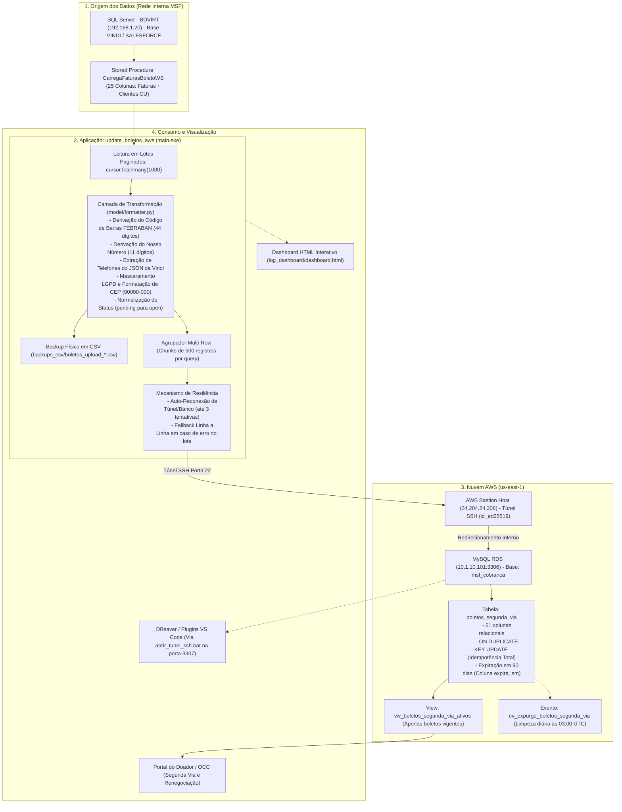

# update_boletos_aws — Sincronização de Boletos (SQL Server ➔ AWS MySQL via SSH)

Aplicação modular de alta performance e resiliência desenvolvida pela equipe de tecnologia de **Médicos Sem Fronteiras (MSF)** para extração, tratamento, enriquecimento e sincronização de dados de cobrança por **Boletos Bancários** do **SQL Server local** para o banco de dados **MySQL hospedado na AWS (RDS)**, utilizando **Túnel SSH autenticado por certificado (`id_ed25519`)** através do servidor Bastion.

A base alimenta diretamente a página web e a aplicação de segunda via de boletos e renegociação de doações de MSF (desenvolvida com a equipe do OCC / Codebit).

---

## 1. Destaques e Funcionalidades Principais

* **Alta Performance Multi-Row (60.000 registros em ~2 minutos):** Em vez de enviar registro a registro (o que levaria mais de 2 horas devido aos 132ms de latência de rede entre Brasil e AWS US-East-1), a aplicação agrupa as inserções em **blocos multi-row de 500 registros por query**, reduzindo 60.000 requisições de rede para apenas 120.
* **Auto-Reconexão com Retries (Self-Healing):** Se o túnel SSH ou a conexão MySQL oscilarem durante uma sincronização pesada, a aplicação detecta o erro de socket, executa rollback com segurança, reabre o túnel SSH e a sessão MySQL automaticamente e retenta o lote atual até 3 vezes antes de prosseguir.
* **Isolamento de Falhas por Registro (Fallback Resiliente):** Se algum bloco de 500 registros contiver 1 boleto com dados inconsistentes, o bloco é automaticamente desmembrado e enviado linha a linha. O registro falho é isolado nos logs/dashboard e os outros 499 registros válidos são gravados com sucesso.
* **Garantia Total de Idempotência:** Suportada pelas chaves exclusivas `uk_fatura_vindi` e `uk_nosso_numero` e pela cláusula `ON DUPLICATE KEY UPDATE`. O processo pode rodar 1, 2 ou 10 vezes consecutivas sem criar registros duplicados; faturas existentes são apenas atualizadas.
* **Derivação FEBRABAN do Código de Barras (44 dígitos):** O SQL Server/Vindi fornece a linha digitável (47 dígitos) e o código de barras no padrão de fonte de barras. A aplicação deriva matematicamente os 44 dígitos numéricos oficiais padrão FEBRABAN descartando os 3 DVs de bloco, atendendo à constraint `ck_barras`.
* **Tratamento Estruturado de Dados de Clientes:** A procedure `CarregaFaturasBoletoWS` foi atualizada para trazer 25 colunas diretamente do cadastro de clientes (`VINDI.dbo.Customers`), tratando telefones JSON, máscaras LGPD e formatação de CEP com hífen (`00000-000`).
* **Regra de Retenção e Expurgo (90 dias):** Totalmente alinhada com as colunas calculadas pelo MySQL (`tipo_pessoa` e `expira_em`) e com o evento diário de limpeza `ev_expurgo_boletos_segunda_via` (às 03:00 UTC).
* **Backup Físico em CSV:** Exporta automaticamente um arquivo `.csv` formatado em `backups_csv/boletos_upload_*.csv` a cada execução para auditoria contábil e conferência no Excel.
* **Exportação Dedicada de Inconsistências para o DBA:** Quando faturas brutas do SQL Server/Vindi possuem dados corrompidos ou ausentes (ex.: boletos sem linha digitável ou código de barras gerados no gateway), o sistema gera automaticamente o arquivo `backups_csv/inconsistencias_dba_*.csv` contendo todas as 25 colunas originais do SQL Server e o motivo do erro para rápida tratativa com o DBA.
* **Dashboard HTML Interativo com JSON Bruto e Tempo Total:** Gera automaticamente em `log_dashboard/dashboard.html` um relatório com métricas em tempo real, tempo de duração da operação, alertas e botões expansíveis que exibem o JSON bruto retornado pelo SQL Server para cada boleto rejeitado.
* **Atalho para Navegação em Plugins/DBeaver (`abrir_tunel_ssh.bat`):** Script prático que abre o túnel em segundo plano na porta `3307`, permitindo inspecionar o banco de dados visualmente através de qualquer plugin ou client SQL.

---

## 2. Arquitetura e Fluxo da Aplicação



---

## 3. Estrutura do Projeto

```text
update_boletos_aws/
├── controller/
│   └── sync_controller.py          # Orquestrador do fluxo: teste, extração, lotes, CSV e dashboard
├── model/
│   ├── source_sqlserver.py         # Conexão pyodbc com SQL Server e chamada da SP CarregaFaturasBoletoWS
│   ├── formatter.py                # Regras de negócio, derivações FEBRABAN, tratamento de CEP, telefone e CPF
│   └── target_aws_mysql.py         # Cliente MySQL AWS: túnel SSH, multi-row bulk insert, auto-reconexão e retries
├── util/
│   └── paths.py                    # Resolução de caminhos compatível com script Python e executável .exe
├── log_dashboard/
│   ├── dashboard_generator.py      # Gerador do painel web HTML responsivo com Bootstrap 5
│   └── dashboard.html              # Relatório interativo de saída atualizado a cada execução
├── ssh/
│   ├── id_ed25519                  # Chave privada com passphrase oficial da AWS
│   └── id_ed25519_nopass           # Chave privada descriptografada para plugins/DBeaver
├── logs/                           # Arquivos de log por execução: exec_YYYY-MM-DD_HH-MM-SS.log
├── backups_csv/                    # Cópias físicas formatadas (boletos_upload_*.csv e inconsistencias_dba_*.csv)
├── config.ini                      # Arquivo central de configurações e credenciais (ignorado no Git)
├── config.example.ini              # Modelo documentado para novos deploys e ambientes
├── main.py                         # Ponto de entrada com argumentos CLI (check, testmode, normal)
├── main.exe                        # Executável compilado standalone (pronto para servidor sem Python)
├── Compilador.bat                  # Script de compilação PyInstaller com backup automático de versão
├── rodar_update.bat                # Executa a sincronização completa normal (produção)
├── rodar_teste.bat                 # Executa teste rápido com 1 lote limitado
├── testar_procedure.bat            # Diagnóstico rápido de conectividade com a SP no SQL Server
├── testar_mysql.bat                # Diagnóstico rápido de conectividade e schema no MySQL AWS
├── abrir_tunel_ssh.bat             # Atalho para abrir o túnel na porta 3307 para DBeaver / Plugins
├── instrutivo-111140-acesso.md     # Instruções técnicas de manutenção e chaves AWS
└── README.md                       # Documentação técnica oficial
```

---

## 4. Origem dos Dados — Stored Procedure `CarregaFaturasBoletoWS`

A procedure reside no banco **`VINDI`** do servidor SQL Server e retorna **25 colunas**:

```sql
ALTER PROCEDURE CarregaFaturasBoletoWS  
    @InicioDataVencimento DATE, 
    @FinalDataVencimento DATE
AS
BEGIN
    SELECT 
        B.ID IdFatura,
        BC.id_charge IdCharge,
        CU.name,
        BC.[last_transaction.gateway_response_fields.barcode],
        BC.[last_transaction.gateway_response_fields.typeable_barcode],
        B.[customer.id] CustomerId,
        BC.due_at,
        BC.amount,
        BC.[last_transaction.amount],  
        D.CreatedDate,
        D.Gateway_Opportunity_ID, 
        D.Id, 
        D.MetodoPagamento__c, 
        D.Gateway_ID__c, 
        BC.status,
        -- Colunas de Endereço e Contato integradas diretamente:
        CU.registry_code                AS CPF,
        CU.email                        AS Email,
        CU.phones                       AS Telefone,
        CU.[address.street]             AS Endereco,
        CU.[address.number]             AS Numero,
        CU.[address.additional_details] AS Complemento,
        CU.[address.neighborhood]       AS Bairro,
        CU.[address.city]               AS Cidade,
        CU.[address.state]              AS Estado,
        CU.[address.zipcode]            AS CEP
    FROM SALESFORCE.DBO.Doacao D (NOLOCK)
    JOIN VINDI.dbo.Bills B (NOLOCK) ON B.CODE = D.Id 
    JOIN VINDI.dbo.BillsCharge BC (NOLOCK) ON BC.P_bills_id = B.id 
    JOIN VINDI.dbo.Customers CU (NOLOCK) ON CU.id = B.[customer.id]
    WHERE BC.due_at >= @InicioDataVencimento
      AND BC.due_at < @FinalDataVencimento
      AND D.MetodoPagamento__c = 'BOLETO'
      AND D.Gateway_ID__c = 'VINDI'
      AND BC.[payment_method.code] LIKE '%SLIP%'
      AND BC.status = 'pending'
      AND ISNULL(B.[subscription.id],'') <> ''
      AND ISNULL(D.npe03__Recurring_Donation__c,'') <> '';
END;
```

---

## 5. Destino dos Dados — Tabela Oficial `boletos_segunda_via` (MySQL AWS)

A tabela de destino oficial possui **51 colunas**, com constraints rígidas de integridade:

| Coluna | Tipo | Regra / Transformação (`model/formatter.py`) |
|---|---|---|
| `id` | `BIGINT UNSIGNED` | `AUTO_INCREMENT` — **Não inserido** (gerado pelo MySQL). |
| `lote` | `VARCHAR(80)` | Identificador do lote (ex.: `SP_CarregaFaturasBoletoWS_YYYYMMDD`). |
| `numero_documento` | `VARCHAR(20)` | Número de documento do boleto. |
| `nosso_numero` | `CHAR(11)` | 11 dígitos numéricos extraídos da linha digitável Bradesco. Atende `ck_nosso_numero`. |
| `carteira` | `CHAR(2)` | Carteira de cobrança (`09`). |
| `id_fatura_vindi` | `BIGINT UNSIGNED` | ID da fatura na Vindi (`billId`). Chave única `uk_fatura_vindi`. |
| `id_cobranca_vindi` | `BIGINT UNSIGNED` | ID da cobrança Vindi (`chargeId`). |
| `id_assinatura_vindi` | `BIGINT UNSIGNED` | ID da assinatura recorrente (quando houver). |
| `code_oportunidade` | `VARCHAR(40)` | ID de 18 caracteres da Oportunidade no Salesforce. |
| `metodo_pagamento` | `VARCHAR(50)` | `online_bank_slip_bradesco_recorrente`. |
| `status_vindi` | `VARCHAR(20)` | Status bruto da Vindi (`pending`, `paid`, etc.). |
| `status` | `ENUM('open','paid','settled')` | Status mapeado para a aplicação (`pending` ➔ `open`). |
| `situacao_doador` | `ENUM('Adimplente','Inadimplente')` | Situação cadastral do doador. |
| `pago_em` | `DATETIME` | Data e hora de liquidação (quando pago). |
| `nome_curto` | `VARCHAR(60)` | Primeiro e último nome do doador para saudação na carta/portal. |
| `nome_completo` | `VARCHAR(120)` | Nome completo do titular do boleto. |
| `email` | `VARCHAR(120)` | E-mail do doador. |
| `cpf_cnpj` | `VARCHAR(14)` | Apenas dígitos (11 para CPF ou 14 para CNPJ). Atende `ck_cpf_cnpj`. |
| `tipo_pessoa` | `CHAR(2)` | `STORED GENERATED` — **Não inserido** (MySQL calcula `PF` ou `PJ`). |
| `receber_carta` | `VARCHAR(10)` | Preferência de envio de carta. |
| `logradouro` | `VARCHAR(80)` | Rua / Avenida do doador. |
| `numero_endereco` | `VARCHAR(10)` | Número do imóvel (ou `S/N`). |
| `complemento` | `VARCHAR(40)` | Apartamento, bloco, sala, etc. |
| `cep` | `CHAR(9)` | Formatado com traço (`00000-000`). |
| `bairro` | `VARCHAR(60)` | Bairro do endereço. |
| `cidade` | `VARCHAR(60)` | Cidade do doador. |
| `uf` | `CHAR(2)` | Sigla do estado em maiúsculas (`RJ`, `SP`, `MG`, etc.). |
| `pais` | `CHAR(2)` | Fixo `BR`. |
| `telefone_tipo` | `ENUM('mobile','landline')` | Extraído do array JSON de telefones da Vindi. |
| `telefone_numero` | `VARCHAR(20)` | Número de telefone com DDI (ex.: `5521999999999`). |
| `telefone_ramal` | `VARCHAR(10)` | Ramal telefônico (se houver). |
| `banco_codigo` | `CHAR(3)` | Fixo `237` (Banco Bradesco). |
| `banco_nome` | `VARCHAR(30)` | Fixo `Bradesco`. |
| `agencia` | `CHAR(4)` | Fixo `3176`. |
| `conta` | `CHAR(7)` | Fixo `0742956`. |
| `conta_digito` | `CHAR(1)` | Fixo `8`. |
| `beneficiario` | `VARCHAR(150)` | Razão social, endereço e CNPJ de Médicos Sem Fronteiras. |
| `local_pagamento` | `VARCHAR(120)` | `EM QUALQUER BANCO OU CORRESPONDENTE NÃO BANCÁRIO.` |
| `especie_doc` | `VARCHAR(10)` | Fixo `Outros`. |
| `aceite` | `CHAR(1)` | Fixo `N`. |
| `data_emissao` | `DATE` | Data de emissão (ISO `AAAA-MM-DD`). |
| `data_vencimento` | `DATE` | Data de vencimento real (ISO `AAAA-MM-DD`). Atende `ck_vencimento`. |
| `data_vencimento_sugerida` | `DATE` | Vencimento impresso/sugerido (ou `NULL`). |
| `vencimento_frente_carta` | `VARCHAR(30)` | Texto amigável da carta (ex.: `16 DE NOVEMBRO`). |
| `valor` | `DECIMAL(12,2)` | Valor nominal do boleto (> 0). Atende `ck_valor`. |
| `linha_digitavel` | `CHAR(47)` | 47 dígitos numéricos limpos (sem pontos ou espaços). Atende `ck_linha`. |
| `codigo_barras` | `CHAR(44)` | 44 dígitos FEBRABAN derivados da linha digitável. Atende `ck_barras`. |
| `pdf_url` | `VARCHAR(255)` | URL pública da fatura na Vindi (`https://app.vindi.com.br/customer/charges/...`). |
| `expira_em` | `DATE` | `STORED GENERATED` — **Não inserido** (`data_vencimento + INTERVAL 90 DAY`). |
| `criado_em` | `DATETIME` | `DEFAULT CURRENT_TIMESTAMP` — **Não inserido**. |
| `atualizado_em` | `DATETIME` | `ON UPDATE CURRENT_TIMESTAMP` — **Não inserido**. |

---

## 6. Derivação do Código de Barras FEBRABAN (44 dígitos)

A especificação bancária FEBRABAN define que a linha digitável possui **47 dígitos**, divididos em 5 campos com 3 Dígitos Verificadores (DVs) intermediários que **não existem** no código de barras original:

```text
Linha Digitável (47 dígitos):
[ Campo 1: 9 úteis + DV1 ] [ Campo 2: 10 úteis + DV2 ] [ Campo 3: 10 úteis + DV3 ] [ Campo 4: DV Geral ] [ Campo 5: Fator + Valor (14) ]
```

A função `linha_digitavel_para_codigo_barras_44()` em `model/formatter.py` realiza a reconstrução exata:
1. Extrai `banco_moeda` = 4 primeiros dígitos do Campo 1 (`c1[0:4]`).
2. Extrai `dv_geral` = Campo 4 (`c4`).
3. Extrai `fator_valor` = Campo 5 (14 dígitos).
4. Extrai `campo_livre` = 5 dígitos finais de `c1` + 10 dígitos úteis de `c2` + 10 dígitos úteis de `c3`.
5. **Resultado:** `banco_moeda + dv_geral + fator_valor + campo_livre` = **Exatamente 44 dígitos numéricos**, compatível com a constraint `ck_barras`.

---

## 7. Configuração (`config.ini`)

```ini
[banco]
# Servidor SQL Server de origem
servidor_ip = 192.168.1.20
database = VINDI
procedure_name = CarregaFaturasBoletoWS
connect_timeout_seconds = 10

[FILTRO]
# Deixe em branco para cálculo automático (mês corrente até faturas futuras)
data_inicio = 
data_fim = 

[AMBIENTE]
# sandbox = homologação na AWS via túnel SSH
# prod = produção oficial
ambiente = sandbox

[SSH]
use_ssh_tunnel = true
ssh_host = 34.204.24.206
ssh_port = 22
ssh_user = davis.vasconcellos
ssh_key_path = ssh/id_ed25519
ssh_key_passphrase = Codebit@msf2026.

[MYSQL_AWS]
mysql_url = 
mysql_host = 10.1.10.101
mysql_port = 3306
mysql_user = davis.vasconcellos
mysql_password = {V)>sOucd6%L2qbBITpa
mysql_database = msf_cobranca
mysql_target_table = boletos_segunda_via

[PROCESSAMENTO]
test_mode = false
max_records = 1000
db_query_timeout_seconds = 300
db_fetch_chunk_size = 1000
last_sync_timestamp = 
gerar_csv_backup = true
diretorio_csv_backup = backups_csv/

[LOG]
diretorio = logs/
dashboard_html = log_dashboard/dashboard.html
```

---

## 8. Como Executar

### 8.1. Via Scripts Batch (.bat)
* **[rodar_update.bat](file:///c:/Users/davis.vasconcellos/OneDrive%20-%20MSF/Documentos/MSF/PHYTON/update_boletos_aws/rodar_update.bat):** Execução normal em produção/homologação de todos os boletos.
* **[rodar_teste.bat](file:///c:/Users/davis.vasconcellos/OneDrive%20-%20MSF/Documentos/MSF/PHYTON/update_boletos_aws/rodar_teste.bat):** Execução de teste enviando 1 único lote para conferência.
* **[testar_procedure.bat](file:///c:/Users/davis.vasconcellos/OneDrive%20-%20MSF/Documentos/MSF/PHYTON/update_boletos_aws/testar_procedure.bat):** Diagnóstico rápido de conexão e colunas retornadas pela procedure no SQL Server.
* **[testar_mysql.bat](file:///c:/Users/davis.vasconcellos/OneDrive%20-%20MSF/Documentos/MSF/PHYTON/update_boletos_aws/testar_mysql.bat):** Diagnóstico de conectividade com o MySQL AWS via túnel SSH e contagem de registros.
* **[abrir_tunel_ssh.bat](file:///c:/Users/davis.vasconcellos/OneDrive%20-%20MSF/Documentos/MSF/PHYTON/update_boletos_aws/abrir_tunel_ssh.bat):** Abre a porta local `3307` em túnel com a AWS para você conectar seu DBeaver, MySQL Workbench ou extensão do VS Code diretamente.

### 8.2. Linha de Comando (CLI)
```bash
# Diagnóstico completo simultâneo (SQL Server e MySQL AWS):
main.exe check

# Modo teste limitado a 10 boletos:
main.exe testmode 10

# Modo normal completo:
main.exe normal
```

---

## 9. Como Recompilar o Executável (`main.exe`)

O script **`Compilador.bat`** automatiza a compilação:
1. Executa o PyInstaller com a flag `--onefile`;
2. Cria backup com carimbo de data/hora do `.exe` anterior;
3. Substitui o `main.exe` na raiz do projeto.

---

## 10. Implantação no Servidor de Produção MSF

Para colocar a rotina para rodar automaticamente todos os dias no servidor da MSF:
1. Copie a pasta do projeto para o disco do servidor (ex.: `D:\Programas\update_boletos_aws\`).
2. Abra o **Agendador de Tarefas do Windows (Task Scheduler)**.
3. Crie uma Tarefa Básica:
   * **Nome:** `Sincronizacao_Boletos_AWS`
   * **Disparador:** Diariamente (ex.: às 04:00 da manhã).
   * **Ação:** Iniciar um programa.
   * **Programa/script:** `D:\Programas\update_boletos_aws\rodar_update.bat`
   * **Iniciar em (obrigatório):** `D:\Programas\update_boletos_aws\`
4. Marque a opção: *"Executar estando o usuário conectado ou não"*.

---

## 11. Resolução de Problemas (Troubleshooting)

| Sintoma / Erro | Causa Provável | Solução |
| :--- | :--- | :--- |
| `Cannot parse privateKey: OpenSSH key integrity check failed` | A extensão/plugin do VS Code falhou ao ler chave ed25519 com senha. | Utilize o arquivo `ssh/id_ed25519_nopass` sem passphrase ou abra o túnel pelo `abrir_tunel_ssh.bat`. |
| `Check constraint ck_barras is violated` | Código de barras enviado com caracteres especiais ou quantidade diferente de 44 dígitos. | A função `linha_digitavel_para_codigo_barras_44()` trata e valida os 44 dígitos exatos. |
| `The value specified for generated column 'tipo_pessoa' is not allowed` | Tentativa de fazer `INSERT` em coluna gerada nativa do MySQL. | As colunas `tipo_pessoa` e `expira_em` são `STORED GENERATED` e foram omitidas do `INSERT` no `target_aws_mysql.py`. |
| `Can't connect to MySQL server on '10.1.10.101'` | O túnel SSH não foi iniciado ou a VPN/IP de saída não está autorizada no Bastion. | Verifique se o IP de saída (`200.201.191.98`) está ativo na rede ou VPN corporativa de MSF. |
